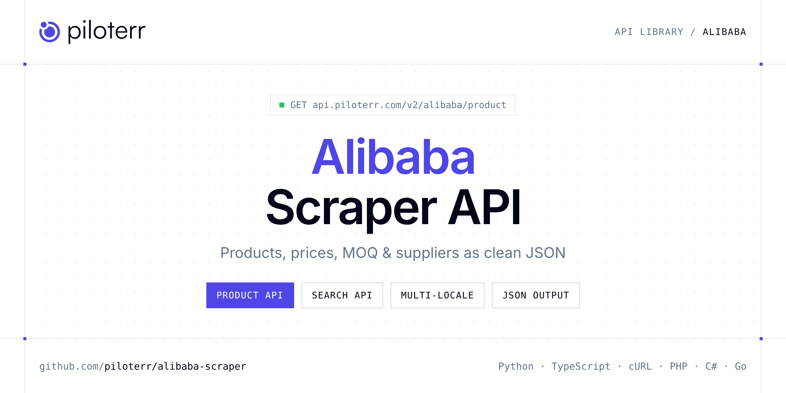

<p align="center">
  <a href="https://www.piloterr.com"></a>
</p>

# Alibaba Scraper API

[](https://discord.gg/CFj3ph8aHU) [](https://app.piloterr.com) [](https://app.piloterr.com/openapi) [](LICENSE)

The **Piloterr Alibaba Scraper API** lets you extract public data from [Alibaba.com](https://www.alibaba.com) — product details, tiered quantity prices, minimum order quantities (MOQ), supplier profiles, product attributes, lead times and keyword search results — as **clean, structured JSON**. No proxies, no headless browsers, no HTML parsing to maintain: send a product URL, a product ID or a keyword and get ready-to-use data back.

Use it to build supplier sourcing tools, B2B price monitoring, product research dashboards, catalog enrichment pipelines or market intelligence datasets on top of Alibaba.

| Endpoint | Path | Credits | What you get |
|---|---|---|---|
| [Alibaba Product API](#alibaba-product-api) | `/v2/alibaba/product` | 2 | Scrape a single Alibaba product page from its URL or numeric product ID |
| [Alibaba Search API](#alibaba-search-api) | `/v2/alibaba/search` | 1 | Scrape Alibaba search results from a keyword or a full search URL |

## Table of contents

- [How it works](#how-it-works)
- [Alibaba Product API](#alibaba-product-api)
- [Alibaba Search API](#alibaba-search-api)
- [Code examples in other languages](#code-examples-in-other-languages)
- [Practical use cases](#practical-use-cases)
- [Why Piloterr?](#why-piloterr)
- [FAQ](#faq)
- [Related scrapers](#related-scrapers)
- [Support](#support)

## How it works

1. **Create a free Piloterr account** and copy your API key from the [dashboard](https://app.piloterr.com).
2. **Send a `GET` (or `POST`) request** to `https://api.piloterr.com/v2/...` with the header `x-api-key: YOUR_API_KEY`.
3. **Receive structured JSON** — Piloterr handles rendering, proxies, retries and parsing.

```bash
export PILOTERR_API_KEY="your-api-key"
pip install requests        # Python
# TypeScript: Node.js 18+ (native fetch), run with `npx tsx file.ts`
```

> Every endpoint accepts both `GET` (query string) and `POST` (JSON body with the same fields).

## Alibaba Product API

Scrape a single Alibaba product page from its URL or numeric product ID: title, images, price range, quantity price tiers, supplier, attributes and trade data (sales volume, lead time).

`GET | POST https://api.piloterr.com/v2/alibaba/product` · **2 credits per request** · [Full reference](https://www.piloterr.com/library/alibaba-product)

### Request parameters

| Parameter | Type | Required | Description |
|---|---|---|---|
| `query` | string | ✅ | Product URL or numeric product ID (e.g. `1601175379813`). |
| `subdomain` | string | — | Locale: `www`, `french`, `portuguese`, … or a full host like `french.alibaba.com`. |
| `return_page_source` | boolean | — | Return the rendered HTML as `{"result": "..."}` instead of parsed JSON. Default `false`. |

### Python example

```python
import os
import requests

response = requests.get(
    "https://api.piloterr.com/v2/alibaba/product",
    headers={"x-api-key": os.environ["PILOTERR_API_KEY"]},
    params={
        "query": "1601175379813",
    },
    timeout=60,
)
response.raise_for_status()
data = response.json()

print(data["title"], data["price"]["display"])
for tier in data["price"]["quantity_prices"]:
    print(tier["min_quantity"], "+ pcs ->", tier["display"])
```

### TypeScript example

```typescript
interface AlibabaProduct {
  product_id: number;
  title: string;
  url: string;
  locale_host: string;
  images: string[];
  price: {
    min: number | null;
    max: number | null;
    display: string | null;
    unit: string;
    quantity_prices: {
      min_quantity: number;
      max_quantity?: number;
      price: number;
      price_usd?: number;
      display: string;
    }[];
  };
  seller: {
    company_name: string;
    company_id: number;
    country: string;
    years: string;
    is_gold_supplier: boolean;
    profile_url: string;
  };
  attributes: { name: string; value: string }[];
  trade: {
    sales_volume: string;
    lead_time: { min_quantity: number; max_quantity?: number; process_period_days: number }[];
  };
}

const params = new URLSearchParams({
  "query": "1601175379813",
});

const response = await fetch(`https://api.piloterr.com/v2/alibaba/product?${params}`, {
  headers: { "x-api-key": process.env.PILOTERR_API_KEY! },
});
if (!response.ok) throw new Error(`Piloterr error ${response.status}: ${await response.text()}`);

const data = (await response.json()) as AlibabaProduct;

console.log(data.title, data.price.display);
for (const tier of data.price.quantity_prices) {
  console.log(`${tier.min_quantity}+ pcs -> ${tier.display}`);
}
```

**More request examples**

```http
GET https://api.piloterr.com/v2/alibaba/product?query=1601175379813&subdomain=portuguese
GET https://api.piloterr.com/v2/alibaba/product?query=https://www.alibaba.com/product-detail/Custom-Neon-Light-Acrylic-Neon-Sign_1601175379813.html
```

<details>
<summary><b>POST variant</b></summary>

```http
POST https://api.piloterr.com/v2/alibaba/product
x-api-key: YOUR_API_KEY
Content-Type: application/json

{"query": "1601175379813"}
```
</details>

### Output example

Example response from the API reference, abridged — real values depend on the page you scrape.

```json
{
  "product_id": 1601175379813,
  "title": "Custom Neon Light Acrylic Neon Sign",
  "url": "https://www.alibaba.com/product-detail/Custom-Neon-Light-Acrylic-Neon-Sign_1601175379813.html",
  "locale_host": "www.alibaba.com",
  "images": [
    "https://s.alicdn.com/@sc04/kf/....jpg"
  ],
  "price": {
    "min": 14.9,
    "max": 19.9,
    "display": "US$14.90 - 19.90",
    "unit": "piece",
    "quantity_prices": [
      {
        "min_quantity": 1,
        "max_quantity": 49,
        "price": 19.9,
        "display": "US$19.90"
      },
      {
        "min_quantity": 50,
        "price": 14.9,
        "display": "US$14.90"
      }
    ]
  },
  "seller": {
    "company_name": "Example Lighting Co., Ltd.",
    "company_id": 123456789,
    "country": "CN",
    "years": "6",
    "is_gold_supplier": true,
    "profile_url": "https://example.en.alibaba.com"
  },
  "attributes": [
    {
      "name": "Material",
      "value": "Acrylic"
    }
  ],
  "trade": {
    "sales_volume": "1,200 sold",
    "lead_time": [
      {
        "min_quantity": 1,
        "max_quantity": 100,
        "process_period_days": 7
      }
    ]
  }
}
```

### Response fields

| Field | Type | Description |
|---|---|---|
| `product_id` | number | Alibaba product ID |
| `title` | string | Localized product title |
| `url` | string | Canonical product URL |
| `locale_host` | string | Host used for rendering, e.g. `portuguese.alibaba.com` |
| `images` | string[] | HD image URLs |
| `price.min / price.max` | number | null | Price range |
| `price.display / price.unit` | string | Localized price label and unit (piece, set…) |
| `price.quantity_prices[]` | object[] | Quantity tiers: `min_quantity`, `max_quantity`, `price`, `price_usd`, `display` |
| `seller` | object | `company_name`, `company_id`, `country`, `years`, `is_gold_supplier`, `profile_url` |
| `attributes[]` | object[] | Product specs as `name` / `value` pairs |
| `trade` | object | `sales_volume` and `lead_time[]` (`min_quantity`, `max_quantity`, `process_period_days`) |

## Alibaba Search API

Scrape Alibaba search results from a keyword or a full search URL: 20 listings per page with title, price range, MOQ, supplier, rating, reviews and sold count, plus pagination metadata.

`GET | POST https://api.piloterr.com/v2/alibaba/search` · **1 credit per request** · [Full reference](https://www.piloterr.com/library/alibaba-search)

### Request parameters

| Parameter | Type | Required | Description |
|---|---|---|---|
| `query` | string | ✅ | Keyword (e.g. `neon`) or a full Alibaba search URL. |
| `subdomain` | string | — | Locale for keyword searches (`www`, `french`, `portuguese`, …). Ignored when `query` is a URL. |
| `page` | integer | — | 1-based page number. Default `1`, 20 results per page. |
| `return_page_source` | boolean | — | Return the raw source as `{"result": "..."}`. Default `false`. |

### Python example

```python
import os
import requests

response = requests.get(
    "https://api.piloterr.com/v2/alibaba/search",
    headers={"x-api-key": os.environ["PILOTERR_API_KEY"]},
    params={
        "query": "neon",
        "page": "1",
    },
    timeout=60,
)
response.raise_for_status()
data = response.json()

for item in data["results"]:
    print(item["title"], "|", item.get("price_text"), "|", item.get("min_order"))
print("Next page:", data["next"])
```

### TypeScript example

```typescript
interface AlibabaSearch {
  results: {
    product_id: string;
    title: string;
    listing_url: string;
    image_url: string;
    price_text?: string;
    price_min?: number;
    price_max?: number;
    min_order?: string;
    category?: string | null;
    seller_name: string;
    seller_id: string;
    rating?: number;
    review_count?: number;
    sold_count?: number;
  }[];
  page: number;
  per_page: number;
  total_results: number;
  total_pages: number;
  next: boolean;
}

const params = new URLSearchParams({
  "query": "neon",
  "page": "1",
});

const response = await fetch(`https://api.piloterr.com/v2/alibaba/search?${params}`, {
  headers: { "x-api-key": process.env.PILOTERR_API_KEY! },
});
if (!response.ok) throw new Error(`Piloterr error ${response.status}: ${await response.text()}`);

const data = (await response.json()) as AlibabaSearch;

for (const item of data.results) {
  console.log(item.title, '|', item.price_text, '|', item.min_order);
}
console.log('Next page:', data.next);
```

**More request examples**

```http
GET https://api.piloterr.com/v2/alibaba/search?query=neon&subdomain=french&page=2
GET https://api.piloterr.com/v2/alibaba/search?query=https://portuguese.alibaba.com/search/page?SearchText=neon
```

<details>
<summary><b>POST variant</b></summary>

```http
POST https://api.piloterr.com/v2/alibaba/search
x-api-key: YOUR_API_KEY
Content-Type: application/json

{"query": "neon", "page": 1}
```
</details>

### Output example

Example response from the API reference, abridged — real values depend on the page you scrape.

```json
{
  "results": [
    {
      "product_id": "1601175379813",
      "title": "Custom Neon Light Acrylic Neon Sign",
      "listing_url": "https://www.alibaba.com/product-detail/_1601175379813.html",
      "image_url": "https://s.alicdn.com/@sc04/kf/....jpg",
      "price_text": "US $14.90-$19.90",
      "price_min": 14.9,
      "price_max": 19.9,
      "min_order": "1 piece",
      "seller_name": "Example Lighting Co., Ltd.",
      "seller_id": "123456789",
      "rating": 4.8,
      "review_count": 52,
      "sold_count": 1200
    }
  ],
  "page": 1,
  "per_page": 20,
  "total_results": 10000,
  "total_pages": 500,
  "next": true
}
```

### Response fields

| Field | Type | Description |
|---|---|---|
| `results[].product_id` | string | Alibaba product ID |
| `results[].title` | string | Product title (HTML cleaned) |
| `results[].listing_url / image_url` | string | Product URL and main thumbnail |
| `results[].price_text / price_min / price_max` | string / number | Display price range and numeric bounds |
| `results[].min_order` | string | MOQ label, e.g. `1 piece` |
| `results[].seller_name / seller_id` | string | Supplier company |
| `results[].rating / review_count / sold_count` | number | Social proof, when shown |
| `page / per_page / total_results / total_pages / next` | pagination | Pagination metadata |

## Code examples in other languages

Ready-to-run examples live in the [`examples/`](examples) folder. Each one reads your key from the `PILOTERR_API_KEY` environment variable.

| Language | Product | Search |
|---|---|---|
| cURL (Bash) | [`product`](examples/curl/product.sh) | [`search`](examples/curl/search.sh) |
| PHP | [`product`](examples/php/product.php) | [`search`](examples/php/search.php) |
| C# | [`product`](examples/csharp/Product.cs) | [`search`](examples/csharp/Search.cs) |
| Go | [`product`](examples/go/product.go) | [`search`](examples/go/search.go) |
| Java | [`product`](examples/java/ProductExample.java) | [`search`](examples/java/SearchExample.java) |
| Ruby | [`product`](examples/ruby/product.rb) | [`search`](examples/ruby/search.rb) |
| Node.js | [`product`](examples/nodejs/product.mjs) | [`search`](examples/nodejs/search.mjs) |

## Practical use cases

- **Supplier sourcing** — Compare suppliers, Gold Supplier status, years on platform and country of origin for any product category.
- **B2B price monitoring** — Track tiered quantity prices and MOQ over time to negotiate better or detect market shifts.
- **Product research** — Find trending products from search results using sold counts, ratings and review volumes.
- **Catalog enrichment** — Pull HD images, specs and attributes to enrich your PIM or marketplace listings.
- **Market intelligence** — Build datasets across locales (`french`, `portuguese`, …) for pricing and competition analysis.

## Why Piloterr?

- **No infrastructure** — no proxies, headless browsers or CAPTCHA solving to run yourself.
- **Structured JSON** — stable, documented fields instead of brittle HTML selectors.
- **Pay per request** — transparent credit cost per endpoint, failed requests are retried for you.
- **One API key, hundreds of sources** — Alibaba plus many other e-commerce, search and company data endpoints in the [Piloterr library](https://www.piloterr.com/library).
- **Any language** — plain HTTPS + JSON, with examples for Python, TypeScript, cURL, PHP, C#, Go, Java, Ruby and Node.js.

## FAQ

### Is it legal to scrape Alibaba?

Collecting publicly available data is generally allowed in many jurisdictions, but rules depend on your country, the data you collect and how you use it. Avoid personal data, respect the website's terms where they apply, and get legal advice for your specific use case. This is not legal advice.

### Do I need proxies or a headless browser?

No. Piloterr handles rendering, proxy rotation and retries on its side. You only send an HTTPS request with your `x-api-key` header and receive JSON.

### How much does a request cost?

The Product endpoint costs **2 credits** per request and the Search endpoint **1 credit** per request. See the [Piloterr website](https://www.piloterr.com) for plans.

### Can I scrape localized Alibaba sites?

Yes. Pass `subdomain` (e.g. `french`, `portuguese`) or a localized URL such as `https://portuguese.alibaba.com/...`. Titles, prices and units are returned in that locale.

### How do I paginate Alibaba search results?

Use the `page` parameter (1-based, 20 results per page) and keep requesting while the response field `next` is `true`.

### Can I get the raw HTML instead of JSON?

Yes. Set `return_page_source=true` and the response becomes `{"result": "..."}` with the page source.

### Which languages are supported?

Any language that can make an HTTP request. This README shows Python and TypeScript; the [`examples/`](examples) folder contains cURL, PHP, C#, Go, Java, Ruby and Node.js.

## Related scrapers

- [AliExpress Scraper API](https://github.com/piloterr/aliexpress-scraper)
- [All Piloterr scrapers on GitHub](https://github.com/piloterr)

## Support

- 💬 Join the [Piloterr Discord](https://discord.gg/CFj3ph8aHU) to ask questions and share what you build.
- 📚 Browse the [API reference (OpenAPI)](https://app.piloterr.com/openapi) and the [Piloterr library](https://www.piloterr.com/library).
- 🔑 [Get your API key](https://app.piloterr.com).

---

<p align="center">
  <a href="https://www.piloterr.com">
    <picture>
      <source media="(prefers-color-scheme: dark)" srcset="images/logo-dark.svg">
      
    </picture>
  </a>
  <br>
  <sub>Built by <a href="https://www.piloterr.com">Piloterr</a> — web scraping APIs for e-commerce, search, real estate and more, one API key.</sub>
</p>

<sub>Alibaba is a trademark of its respective owner. This repository is not affiliated with or endorsed by Alibaba. Examples are released under the MIT license.</sub>
